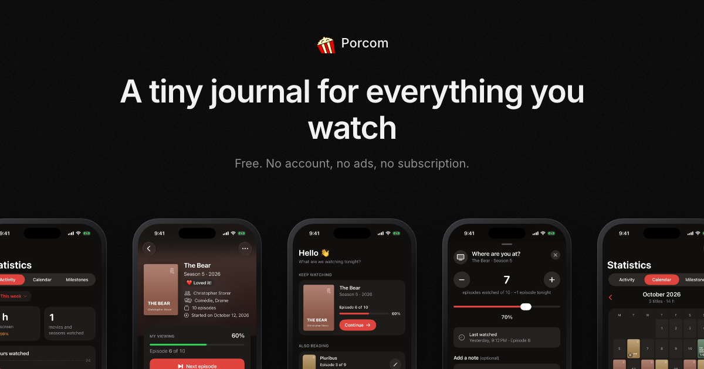

  

<h1 align="center">Porcom</h1>

<strong>A tiny journal for everything you watch.</strong>

  Log your episodes, watch the trailers, and give every movie and series your verdict. No account needed.

  <a href="https://porcom.app">porcom.app</a> · <a href="https://porcom.app/fr/">Français</a> · <a href="https://porcom.tumblr.com">The blog</a>

## Made for movie nights

Porcom is an iPhone app for keeping track of the movies and series you watch. It's the app version of the Porcom microblog, where every post is a trailer, a title and a verdict. It's built around the moments you actually watch: an episode before bed, a movie on Friday night, a trailer that makes you want to see something. No feed, no noise, and no sign-up.

## What you can do

- **Add a title in seconds.** Search by title: the poster, summary, cast and trailer come along. A series is added one season at a time, each with its own poster and verdict.
- **Trailer first.** Every title opens on its trailer, playing right in the app, with the Canadian streaming services where you can watch it.
- **Pick up where you left off.** Tap Continue after an episode, or "I watched it" after a movie. Your series and its next episode wait on your Home Screen and Lock Screen with widgets.
- **Give your verdict.** The blog's four: 👎 Meh, 👍 Liked, ❤️ Loved it! and 🔥 Devoured!. Rate the script, characters, acting, directing, visuals, soundtrack and ending too, if you like.
- **Keep the lines that stay with you.** Photograph the subtitles or pick a screenshot, and select the line to keep it as a quote.
- **Spot what's coming.** A Spotted list for what caught your eye in a trailer, often before it's out.
- **Watch the habit grow.** Hours on screen, titles watched and streaks, by week, month or year, by platform and by genre, and a yearly goal.
- **Play along.** Twelve levels from Corn Kernel to Big Screen Legend, milestones to unlock, a challenge each month, and your year on screen every December.
- **Share what you watch.** A title, your calendar or your year as an image, for a post or a story.
- **Keep your journal yours.** Synced with your private iCloud, backed up to a file whenever you like, and exported to CSV for Letterboxd.

## Private by default

No account, no sign-up, no ads. Your journal is stored on your iPhone and in your private iCloud.

## Download

Porcom is coming soon to the App Store, for iPhone.

---

## En français

**Un petit journal pour tout ce que tu regardes.**

Porcom est une app iPhone pour suivre les films et les séries que tu regardes, la version app du microblogue Porcom. Ajoute un titre, coche tes épisodes et donne ton verdict, sans compte.

- **Ajoute un titre en quelques secondes** : l'affiche, le résumé, la distribution et la bande-annonce arrivent tout seuls, une saison à la fois.
- **La bande-annonce d'abord** : elle joue directement dans l'app, avec les plateformes où regarder le titre au Canada.
- **Reprends là où tu en étais** : Continuer après un épisode, « Je l'ai vu » après un film, et ton prochain épisode sur ton écran d'accueil et ton écran verrouillé.
- **Donne ton verdict** : 👎 Bof, 👍 Aimé, ❤️ Adoré ! ou 🔥 Dévoré !, et note les thèmes si tu veux.
- **Garde tes répliques** (photographie les sous-titres), suis tes heures d'écran, tes séquences et ton objectif annuel, monte de niveau, du Grain de maïs à la Légende du grand écran.
- **Partage ce que tu regardes** en image, et **sauvegarde ou exporte ton journal** (synchro iCloud, fichier Porcom ou CSV pour Letterboxd).

[porcom.app/fr](https://porcom.app/fr/)

---

Made with ♥ by <a href="https://wibeset.ca">Wibeset</a> in Canada

